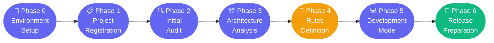

<div align="center">

<picture>
  <source media="(prefers-color-scheme: dark)" srcset="assets/yes-logo-white.png">
  
</picture>

<h1>Platform Guardian</h1>

<p><strong>AI-enforced development governance for the yes+ multi-platform product</strong></p>


</div>

---

## 🎯 What is Platform Guardian?

Platform Guardian is a **Claude Code MCP plugin** that enforces consistent, gated development workflows across all yes+ platform teams. It sits between every developer and Claude, validating every action against the company's shared knowledge repository before allowing execution.

> _No undocumented architecture deviations. No inconsistent AI-generated code across sessions. No developers guessing what "correct" looks like._

---

## 🤔 The Problem

yes+ runs on **7 platforms** developed by separate teams — all using Claude Code. Without governance, this is what happens:

| ❌ Without Platform Guardian | Impact |
|---|---|
| No single source of truth | Every team defines "correct" differently |
| Undocumented architecture decisions | Patterns diverge silently between platforms |
| Claude works from session context alone | Inconsistent code generation per developer |
| Design and spec drift go undetected | Features ship misaligned with Figma |
| New developers have no onboarding baseline | Months to reach production-quality output |

---

## ✅ The Solution — Two Repositories, One Enforced Workflow

```
┌─────────────────────────────────────────────────────────────────────┐
│                        Developer + Claude                           │
│                                                                     │
│   Developer types a request  ──►  Claude proposes an action        │
│                                          │                          │
│                               Platform Guardian checks:             │
│                               • Is the current phase gate met?     │
│                               • Does spec / design / Figma exist?  │
│                               • Is the dependency approved?        │
│                               • Does this match org standards?     │
│                                          │                          │
│                               ✅ Allowed  │  ❌ Blocked (with reason)│
└─────────────────────────────────────────────────────────────────────┘
                                            │
                              reads from    ▼
                    ┌─────────────────────────────────┐
                    │   Org Knowledge Repository      │
                    │   (Repo B — company standards)  │
                    │                                 │
                    │  • Design System                │
                    │  • Architecture decisions       │
                    │  • Approved libraries           │
                    │  • Platform constraints         │
                    │  • Security & QA rules          │
                    └─────────────────────────────────┘
```

| | Repo | Purpose | Owner |
|---|---|---|---|
| 🔧 | **This repo (Platform Guardian)** | MCP plugin — enforces the workflow | Dev Lead |
| 📚 | **Org Knowledge Repo (Repo B)** | Single source of truth for all standards | PM + Architects + Design Lead |

---

## 📱 Supported Platforms

| Platform | Type | Status |
|---|---|---|
| 📱 **iOS Mobile** | Native Swift / SwiftUI | In scope |
| 🤖 **Android Mobile** | Native Kotlin | In scope |
| 🍎 **Apple TV** | tvOS | In scope |
| 📺 **Android TV** | Android / Compose TV | In scope |
| 🖥️ **Tizen** | Samsung Smart TV | In scope |
| 🖥️ **WebOS** | LG Smart TV | In scope |
| 🖥️ **Vidaa** | Hisense Smart TV | In scope |

---

## 🔄 Workflow Phases — Enforced, Sequential, Cannot Be Skipped



| Phase | Name | What it does | Gate to advance |
|---|---|---|---|
| **0** | 🔌 Environment Setup | Connects plugin, verifies Repo B is accessible | Plugin connected + Repo B reachable |
| **1** | 📋 Project Registration | Registers platform type, validates spec + Figma data exists and is current | Spec + Figma present and not stale |
| **2** | 🔍 Initial Audit | Compares codebase against org standards — identifies deviations, missing docs, forbidden patterns | Audit acknowledged by developer + PM |
| **3** | 🏗️ Architecture Analysis | Scans `package.json` / Podfile / build.gradle, maps state management, navigation, network patterns, produces deviation log | Architecture documented |
| **4** | 📐 Rules Definition | Generates CLAUDE.md from org template, fills in platform constraints, forbidden patterns, approved deps | **Human gate: PM + Tech Lead approval** |
| **5** | 💻 Development Mode | Active development with continuous enforcement — every Claude action validated against Repo B | Feature QA complete, no blockers |
| **6** | 🚀 Release Preparation | Final cross-platform consistency check, CI/CD gate validation, release sign-off | All checks green |

> **Phase 4 requires human approval** — PM and Tech Lead must sign off before any code is written. This is intentional and cannot be bypassed.

---

## 🛡️ Three-Layer Enforcement

```mermaid
flowchart TD
    A[Developer action] --> B{Layer 1\nPreToolCall Hook}
    B -->|.platform-guardian/ present| C[Read phase-state.json]
    B -->|not a PG project| PASS1[✅ Pass silently]
    C -->|phase gate not met| BLOCK[❌ Blocked — reason shown]
    C -->|phase gate met| D{Layer 2\nSkill Invocations}
    D -->|phase transition| E[/plan · /review · /workflow · /code-review]
    E -->|passes| F{Layer 3\nHuman Gates}
    F -->|Phase 4| G[PM + Tech Lead approval]
    G -->|approved| PASS2[✅ Phase advances]
    D -->|routine action| PASS2

    style BLOCK fill:#ef4444,color:#fff,stroke:none
    style PASS1 fill:#10b981,color:#fff,stroke:none
    style PASS2 fill:#10b981,color:#fff,stroke:none
    style G fill:#f59e0b,color:#fff,stroke:none
```

| Layer | Mechanism | Cost | When it fires |
|---|---|---|---|
| **1** — Hook | `PreToolCall` hook reads `phase-state.json` | ~1ms, **zero tokens** | Every Edit / Write / Bash call |
| **2** — Skills | `/plan`, `/review`, `/workflow`, `/code-review`, `/peak-quality` | Proportionate to action risk | At phase transitions only |
| **3** — Human | PM + Tech Lead sign-off | Non-automatable | Phase 4 only |

---

## 📚 Knowledge Domains (what must exist in Org Knowledge Repo)

| # | Domain | Why it matters |
|---|---|---|
| 1 | 🎨 **Design System** | Tokens, components, themes, platform adaptations |
| 2 | 📄 **Product Specifications** | Feature definitions, flows, acceptance criteria |
| 3 | 🏛️ **Architecture Decisions** | ADRs, approved libraries, forbidden patterns |
| 4 | 📝 **Development Guidelines** | Coding standards, naming conventions, file structure |
| 5 | 🤖 **AI Work Rules** | Claude allowed/forbidden ops, human gate requirements |
| 6 | 📱 **Platform Constraints** | Per-platform capability matrix and hardware limits |
| 7 | 🧪 **QA & Testing Standards** | Coverage requirements, test types, sign-off criteria |
| 8 | 🚢 **Release & CI/CD** | Build process, deployment pipeline, cross-platform coordination |
| 9 | 🔐 **Security & Privacy** | Auth patterns, data storage rules, compliance requirements |
| 10 | ⚡ **Performance Budgets** | Memory limits and load targets per platform — critical for TV |
| 11 | 🌍 **Localization & i18n** | Language coverage, RTL support, market-specific rules |
| 12 | 📊 **Monitoring & Analytics** | Event taxonomy, error tracking standards |

> ⚡ **Performance Budgets** are especially critical for TV platforms (Tizen, WebOS, Vidaa) which have strict hardware constraints that mobile guidelines do not cover.

---

## 🗂️ Repository Structure

```
yes-platform-guardian/
├── 📦 plugin/                       MCP server (TypeScript)
│   └── src/
│       ├── workflow/                Phase enforcement + gate conditions
│       ├── knowledge/               Org Knowledge Repo connector + cache
│       ├── analysis/                Audit engine + gap analysis
│       └── tools/                   MCP tool definitions
│
├── 📋 workflows/
│   └── phases.yaml                  Phase and gate definitions
│
├── 📐 templates/
│   ├── CLAUDE.md.template           Per-platform CLAUDE.md starter
│   └── project-config.yaml.template Project configuration template
│
├── 🏛️ org-knowledge-template/       Starter structure for Repo B
│
└── 📚 docs/
    ├── process-overview.html        Interactive system overview
    ├── plugin-spec.md               Plugin technical specification
    ├── workflow.md                  Workflow phase specification
    ├── domains.md                   Knowledge domain definitions
    ├── governance.md                Approval and review governance
    ├── backlog.md                   Implementation backlog (~35 sessions)
    └── marketplace-gap-audit.md     Org marketplace audit findings
```

---

## 🚀 Getting Started

> **Note:** The MCP server is in development. The installation below will be the final flow once M1 is complete.

```bash
# 1. Clone this repo
git clone https://github.com/appsadmin-design/yes-platform-guardian.git

# 2. Install and build the plugin
cd yes-platform-guardian/plugin
npm install && npm run build

# 3. Add to your Claude Code settings (~/.claude/settings.json)
{
  "mcpServers": {
    "platform-guardian": {
      "command": "node",
      "args": ["/path/to/yes-platform-guardian/plugin/dist/server.js"],
      "env": {
        "ORG_KNOWLEDGE_REPO": "<repo-b-url-or-local-path>"
      }
    }
  }
}

# 4. Initialize a new project
guardian init
```

---

## 📊 Implementation Status

| Milestone | Item | Status |
|---|---|---|
| Design | System architecture | ✅ Complete |
| Design | 7 workflow phases specified | ✅ Complete |
| Design | 12 knowledge domains defined | ✅ Complete |
| Design | Interactive HTML documentation | ✅ Complete |
| Design | CLAUDE.md + project-config templates | ✅ Complete |
| Design | Org Knowledge Repo template | ✅ Complete |
| Design | Marketplace gap audit (47 gaps) | ✅ Complete |
| Design | Enforcement architecture (SC-2) | ✅ Complete |
| Foundation | Git repository initialized | ✅ Complete |
| Foundation | PreToolCall enforcement hook stub | ✅ Complete |
| **M0.2** | TypeScript project scaffold | 🔜 Next |
| **M1** | MCP server + phase enforcement engine | ⏳ Pending |
| **M2** | Audit engine + architecture analyzer | ⏳ Pending |
| **M3** | CLI + developer experience | ⏳ Pending |
| **M4** | Org Knowledge content (per platform) | ⏳ Pending |

---

## 👥 Governance

| Role | Responsibility |
|---|---|
| **Dev Lead (Tom)** | Plugin repo (this repo) — owner + 1 reviewer per PR |
| **PM + Architects + Design Lead** | Org Knowledge Repo (Repo B) — domain owners approve publish |
| **PM + Tech Lead** | Phase 4 human approval gate — required before any feature code is written |

Marketplace versioning follows semver: **Major** blocks execution, **Minor** warns + re-checks, **Patch** notifies only.

---

<div align="center">
  <sub>Built for yes+ · Enforced by Claude Code · Powered by Anthropic</sub>
</div>
