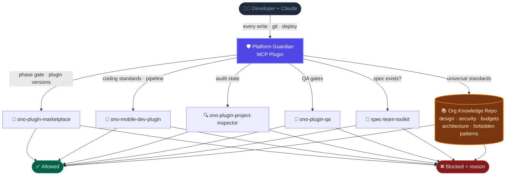
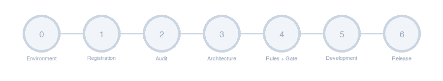

<div align="center">
  
  <h1>Platform Guardian</h1>
  <p><strong>AI-enforced development governance for the yes+ multi-platform product</strong></p>

  
  
  
  
  
</div>

---

> **Platform Guardian** is a Claude Code MCP plugin that enforces consistent, gated development workflows across all yes+ platform teams — connecting every developer to the company's shared plugin ecosystem and knowledge base before any code is written.

---

## 🤔 The Problem

yes+ ships on **7 platforms**, developed by separate teams, all using Claude Code. Without governance:

| Issue | What actually happens |
|---|---|
| 🔀 No single source of truth | Each developer defines "correct" differently per session |
| 🏗️ Undocumented architecture decisions | Patterns diverge silently across iOS, Android, and TV |
| 🤖 Claude works from session context only | Inconsistent code generation every time a new chat opens |
| 🎨 Design and spec drift go undetected | Features ship misaligned with Figma without anyone noticing |
| 🧩 New developers have no baseline | No structured onboarding — months to reach production quality |
| 📺 TV platforms have zero tooling coverage | No standards, no agents, no skills for 5 of 7 platforms |

---

## ✅ The Solution — Two Knowledge Layers, One Enforced Workflow

Platform Guardian reads from **two complementary knowledge layers** depending on the context of each task.

### Layer 1 — Dev Workflow Plugins (the yes+ Marketplace)

Five Claude Code plugin repos that govern *how* developers work: pipeline commands, agents, skills, and platform-specific coding standards.

| Repo | What it provides | Used when |
|---|---|---|
| 🏪 [ono-plugin-marketplace](https://github.com/appsadmin-design/ono-plugin-marketplace) | Plugin registry — lists all approved org plugins and their versions | Always — Platform Guardian validates plugin versions and registry state |
| 📱 [ono-mobile-dev-plugin](https://github.com/appsadmin-design/ono-mobile-dev-plugin) | Dev workflow for Mobile: pipeline commands, coding standards, agents, and skills for iOS / Android / React Native / React web | Feature development on any mobile or web platform |
| 🔍 [ono-plugin-project-inspector](https://github.com/appsadmin-design/ono-plugin-project-inspector) | Project audit engine, state machine, and inspection workflow | Phase 2 (Initial Audit) and Phase 3 (Architecture Analysis) |
| 🧪 [ono-plugin-qa](https://github.com/appsadmin-design/ono-plugin-qa) | QA coverage analysis, Figma validation, test plan tooling | Phase 6 (Release Preparation) and ongoing QA gates |
| 📐 [spec-team-toolkit](https://github.com/appsadmin-design/spec-team-toolkit) | HLD/LLD spec building, Figma-to-spec conversion | Phase 1 — verifying specs exist and are complete before development starts |

### Layer 2 — Org Knowledge Repo *(to be created)*

A standalone git repository — **not a plugin** — that holds universal org-wide standards that apply to all platforms and all projects:

- 🎨 Design system tokens, components, themes
- 🔐 Security and privacy policies
- ⚡ Performance budgets per platform (critical for TV hardware constraints)
- 🏛️ Architecture decisions and approved library list
- 🚫 Org-wide forbidden patterns

> **Why two separate layers?** The marketplace plugins define *how Claude works* during development (workflow, agents, pipeline). The Org Knowledge Repo defines *what the rules are* (standards, constraints, policies). Platform Guardian enforces both — but they serve different purposes and are owned by different teams.

### How it all connects



---

## 📱 Supported Platforms (7)

yes+ has **7 product platforms**. React Native is the cross-platform framework used for iOS Mobile and Android Mobile development — not a separate platform target.

| Platform | Implementation | Tooling today | Target |
|---|---|---|---|
| 📱 **iOS Mobile** | Native Swift / SwiftUI | Standards: empty placeholders — Owner: Boris | 🔴 Not ready |
| 🤖 **Android Mobile** | Native Kotlin | Standards: empty placeholders — Owner: Guy | 🔴 Not ready |
| 🍎 **Apple TV** | tvOS | No coverage in any repo | 🔴 No coverage |
| 📺 **Android TV** | Android / Compose TV | No coverage in any repo | 🔴 No coverage |
| 🖥️ **Tizen** | Samsung Smart TV | No coverage in any repo | 🔴 No coverage |
| 🖥️ **WebOS** | LG Smart TV | No coverage in any repo | 🔴 No coverage |
| 🖥️ **Vidaa** | Hisense Smart TV | No coverage in any repo | 🔴 No coverage |

> **React Native mobile layer** (`ono-mobile-dev-plugin`): all standards, agents (7), and skills (9) fully authored — ready for iOS and Android cross-platform development. Native Swift and Kotlin standards are separately empty (see Org Knowledge Status below).

---

## 🔄 Workflow Phases — Sequential, Enforced, Cannot Be Skipped

<div align="center">
  
</div>

| Phase | Name | What happens | Gate to advance |
|---|---|---|---|
| **0** | 🔌 Environment Setup | Plugin connects, Org Knowledge Repo reachability verified | Claude Code version meets minimum · MCP server online · Org Knowledge Repo reachable · developer has read access |
| **1** | 📋 Project Registration | Platform type registered. Spec documents verified to exist | Platform type registered in `org-knowledge/platforms/` · project repository accessible |
| **2** | 🔍 Initial Audit | Codebase compared against org standards. Deviations, missing docs, and forbidden patterns surfaced. Output must be formally acknowledged by developer + PM | Audit report acknowledged by both developer and PM |
| **3** | 🏗️ Architecture Analysis | `package.json` / Podfile / `build.gradle` scanned. State management, navigation, and network patterns mapped. Deviation log produced | Architecture map documented |
| **4** | 📐 Rules Definition | CLAUDE.md generated from org template — platform constraints, forbidden patterns, approved deps | **⭐ Human gate: PM + Tech Lead approval required** |
| **5** | 💻 Development Mode | Active development. Every Claude action validated against org standards in real time | Feature QA complete, no open blockers |
| **6** | 🚀 Release Preparation | Cross-platform consistency check, CI/CD gate validation, final sign-off | All checks green |

> **Phase 4 is the only phase that requires a human.** PM and Tech Lead must explicitly approve the generated CLAUDE.md before any code is written. This gate cannot be automated and cannot be skipped.

---

## 🛡️ How Enforcement Works

Three layers — each with a different cost and trigger:

**Layer 1 — The instant blocker** *(always on, zero tokens, ~1ms)*

Before any file write, git command, or terminal action, a **PreToolCall hook** checks two things:
1. Is there a Platform Guardian project here? (`.platform-guardian/` folder present)
2. Is the current workflow phase gate satisfied for this action?

If no → the action is **blocked immediately** with a clear reason. No LLM, no cost, no delay. This is the enforcement floor — it fires even when a developer doesn't explicitly invoke anything.

> The alternative (a UserPromptSubmit hook firing on every response) was explicitly considered and rejected: it reviews prose instead of actions, doubles token cost on every message, and doesn't catch what actually matters. PreToolCall is the right enforcement surface.

---

**Layer 2 — Quality gates at phase transitions** *(infrequent, proportionate)*

When advancing between phases, Platform Guardian invokes the right skill:
- `/plan` before any implementation begins
- `/review` or `/workflow` for audit and analysis phases  
- `/code-review` before the Phase 4 human gate
- `/peak-quality` for significant architectural decisions

These run **once per phase transition**, not on every action.

---

**Layer 3 — Human approval** *(Phase 4 only, non-negotiable)*

PM and Tech Lead must read and sign off on the generated CLAUDE.md. No automation. No bypass.

---

## 📚 Org Knowledge Status — What Exists vs. What's Missing

Based on the **July 2026 marketplace audit** (47 gaps identified across all 5 repos).

### Plugin content — per platform

| Platform | Standards | Agents | Skills | Notes |
|---|---|---|---|---|
| ✅ React Native | 6 complete | 7 complete (5 RN + 2 shared) | 9 complete (3 RN + 6 shared) | Fully ready — cross-platform mobile |
| ❌ iOS | 5 empty placeholders | 4 empty | 3 empty | Owner: Boris · Also missing: iOS-specific security and accessibility rules (mobile-security.md and accessibility.md are RN-only) |
| ❌ Android | 5 empty placeholders | 4 empty | 3 empty | Owner: Guy · Same gap: Android-specific security and accessibility rules not authored |
| ❌ React web | 6 empty placeholders | 4 empty | 3 empty | Owner: Magen · Missing XSS/CSRF/CSP security coverage + React ARIA accessibility rules not yet authored |
| ❌ Apple TV | None | None | None | No coverage in any repo |
| ❌ Android TV | None | None | None | No coverage in any repo |
| ❌ Tizen | None | None | None | No coverage — Samsung-specific APIs required |
| ❌ WebOS | None | None | None | No coverage — LG-specific APIs required |
| ❌ Vidaa | None | None | None | No coverage — Hisense-specific APIs required |

### Org Knowledge Repo — universal standards (Layer 2)

The Org Knowledge Repo **does not yet exist** as a git repository. The structure template is in [`org-knowledge-template/`](./org-knowledge-template/). All 12 domains are at "Not started."

| Domain | Status | Owner |
|---|---|---|
| 🎨 Design System (tokens, components, themes) | ❌ Not started | Design Lead |
| 🔐 Security & privacy policies | ❌ Not started | Architect |
| ⚡ Performance budgets per platform | ❌ Not started — critical for TV | Architect |
| 🏛️ Architecture decisions, approved libraries, forbidden patterns | ❌ Not started | Architect |
| 🌍 Localization, RTL, market rules | ❌ Partial in plugins | Magen |
| 📄 Product specifications per feature / platform | ❌ Not started | PM |

---

## 🗂️ Repository Structure

```
yes-platform-guardian/
├── 📦 plugin/                    MCP server (TypeScript — in development)
│   └── src/
│       ├── workflow/             Phase enforcement + gate conditions
│       ├── knowledge/            Knowledge connector + cache (marketplace + Repo B)
│       ├── analysis/             Audit engine + gap analysis
│       └── tools/                MCP tool definitions
│
├── 📋 workflows/
│   └── phases.yaml               Phase and gate definitions
│
├── 📐 templates/
│   ├── CLAUDE.md.template        Per-platform CLAUDE.md starter
│   └── project-config.yaml.template
│
├── 🏛️ org-knowledge-template/    Starter structure for the Org Knowledge Repo (Layer 2)
│
└── 📚 docs/
    ├── process-overview.html     Interactive system overview (open in browser)
    ├── plugin-spec.md            Plugin technical specification
    ├── workflow.md               Workflow phase specification
    ├── domains.md                Knowledge domain definitions
    ├── governance.md             Approval and review governance
    ├── backlog.md                Full implementation backlog (~35 sessions)
    └── marketplace-gap-audit.md  Audit of all 5 org plugin repos (47 gaps)
```

---

## 🚀 Getting Started

> **Platform Guardian is in development.** The flow below reflects the intended installation experience once v1.0 ships. Steps 1–3 will work once the plugin is published to the marketplace (after M1.1). Step 4 is coming in M3.

**Step 1 — Add the yes+ marketplace to your Claude Code settings** *(org-wide, one-time setup)*

```json
{
  "extraKnownMarketplaces": {
    "yes-plugins": {
      "source": {
        "source": "github",
        "repo": "appsadmin-design/ono-plugin-marketplace"
      }
    }
  }
}
```

**Step 2 — Install the platform plugins for your team**

```bash
# For mobile developers (iOS / Android / React Native / React web)
/install-plugin ono-mobile-dev-plugin@yes-plugins

# For project inspection and audit
/install-plugin ono-plugin-project-inspector@yes-plugins

# For QA engineers
/install-plugin ono-plugin-qa@yes-plugins

# For spec / design team
/install-plugin spec-team-toolkit@yes-plugins
```

**Step 3 — Install Platform Guardian**

```bash
/install-plugin yes-platform-guardian@yes-plugins
```

**Step 4 — Initialize a new project** *(coming in M3 — not yet implemented)*

```bash
guardian init
# Prompts for platform type, Figma file IDs, and Org Knowledge Repo location
# Creates .platform-guardian/project-config.yaml and phase-state.json
# Runs Phase 0 checks automatically
```

---

## 📊 Implementation Status

| Milestone | Item | Why it's needed | Status |
|---|---|---|---|
| **Design** | System architecture | The blueprint — without it, nothing else is buildable | ✅ Done |
| **Design** | 7 workflow phases | The enforced sequence every developer must follow | ✅ Done |
| **Design** | 12 knowledge domains | Maps what must exist in each layer for gates to fire | ✅ Done |
| **Design** | Marketplace gap audit | Identifies exactly what's missing before enforcement can work (47 gaps found) | ✅ Done |
| **Design** | Enforcement architecture (SC-2) | The 3-layer mechanism — hook, skills, human gate | ✅ Done |
| **Foundation** | Git repository initialized | Tracks all changes before collaborative work begins | ✅ Done |
| **Foundation** | PreToolCall enforcement hook | Layer 1 installed globally, fires before every write/git action | ✅ Installed *(stub — enforcement logic pending M1.2)* |
| **M0.2** | TypeScript project scaffold | Build system, linter, test runner — the foundation for all plugin code | 🔜 Next |
| **M1** | MCP server + phase engine | The actual plugin — connects to Claude Code and enforces phases | ⏳ |
| **M2** | Audit engine + architecture analyzer | Powers Phase 2 and Phase 3 — the baseline scan for every new project | ⏳ |
| **M3** | CLI + developer experience | `guardian init`, emergency bypass, onboarding docs | ⏳ |
| **M4** | iOS standards, agents, skills | Unlocks iOS gate enforcement — all 12 files currently empty | ⏳ Owner: Boris |
| **M4** | Android standards, agents, skills | Unlocks Android gate enforcement — all 12 files currently empty | ⏳ Owner: Guy |
| **M4** | React web standards, agents, skills | Unlocks React web enforcement | ⏳ Owner: Magen |
| **M4** | TV platform coverage (5 platforms) | Apple TV, Android TV, Tizen, WebOS, Vidaa — zero coverage today | ⏳ To scope |
| **M4** | Org Knowledge Repo (Layer 2) | Universal org standards — the prerequisite for all enforcement gates | ⏳ Owner: Tom + PM + Design Lead + Architect |

Full backlog with ~35 sessions scoped: [`docs/backlog.md`](./docs/backlog.md)

---

## 👥 Team

| Person | Role | Responsibility |
|---|---|---|
| **Tom Zion** | Dev Lead | Platform Guardian plugin (this repo) — owner + 1 reviewer per PR |
| **Magen Yadid** | CTA | Plugin marketplace + mobile dev standards — domain owner |
| **Yagil Cohen** | AI Champion | Project inspector plugin — domain owner |
| **Arditi** | QA Lead | QA plugin (`ono-plugin-qa`) — domain owner |

**Phase 4 human gate:** PM + Tech Lead must approve before any feature code is written. Non-negotiable.

Marketplace versioning follows semver: **Major** blocks execution · **Minor** warns + re-checks · **Patch** notifies only.

---

## 🔗 Resources

| Resource | Link |
|---|---|
| 📊 Project Gantt | [`docs/gantt.html`](./docs/gantt.html) — open locally in browser |
| 🗂️ Full Backlog | [`docs/backlog.md`](./docs/backlog.md) |
| 🔍 Marketplace Gap Audit | [`docs/marketplace-gap-audit.md`](./docs/marketplace-gap-audit.md) |
| 🌐 Interactive System Overview | [`docs/process-overview.html`](./docs/process-overview.html) |
| 📋 Trello Board | *Link to be added* |

---

<div align="center">
  <sub>Built for yes+ · Enforced by Claude Code · Powered by Anthropic</sub>
</div>
